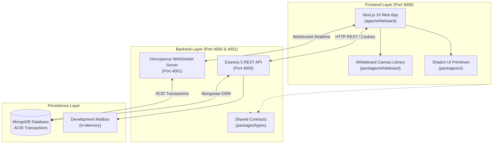
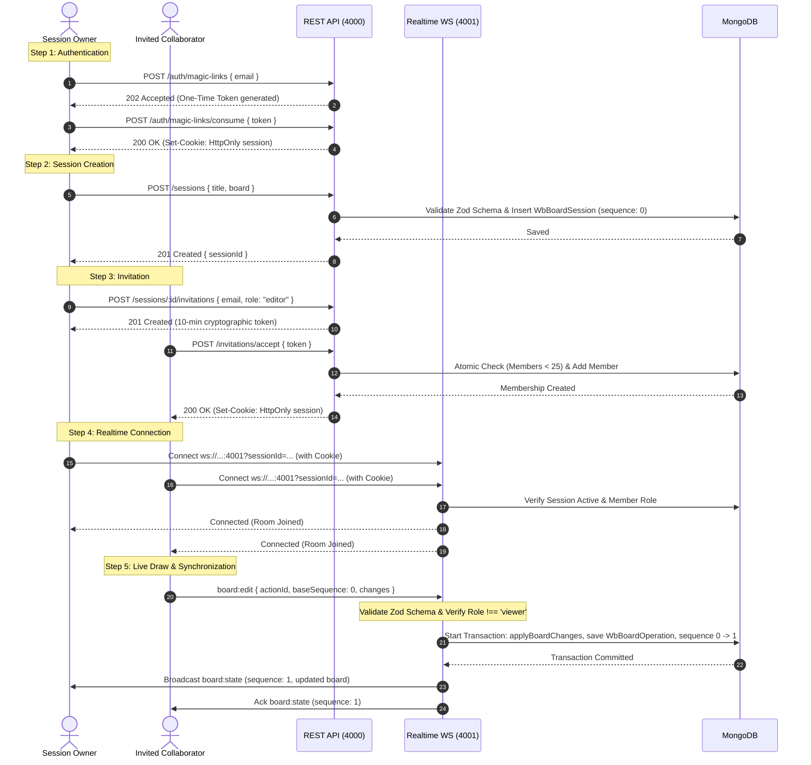

# Orbito — System Architecture & Technical Documentation

Orbito is a high-performance, server-authoritative, real-time collaborative diagramming and whiteboard application built as a modern TypeScript monorepo. It features a standalone SVG drawing engine, Draw.io-style connectors with multi-segment waypoints, zero-password cryptographic magic-link authentication, multi-tenant live collaboration sessions with role-based access control (RBAC), and deterministic XML document export and import.

---

## 1. System Architecture Overview

Orbito follows a **decoupled monorepo architecture** that separates the pure drawing engine, shared design system, HTTP REST API, and realtime WebSocket server into isolated workspace units.



### Workspace Structure

| Workspace Directory | Type | Technology | Purpose |
| :--- | :--- | :--- | :--- |
| `apps/whiteboard` | Application | Next.js 16 (Turbopack), React 19 | Product web application, sidebar, auth modals, invitation manager, room orchestration. |
| `servers/api` | Server | Node.js 22, Express 5, Hocuspocus 4.7 | Dual server: REST API (Port 4000) and WebSocket Realtime engine (Port 4001). |
| `packages/whiteboard` | Library | React 19, SVG, TypeScript | Reusable, framework-agnostic canvas drawing engine, 22 shapes, connectors, XML serializer. |
| `packages/ui` | Library | Radix UI, Tailwind CSS | Shared design system primitives (`Button`, `Dialog`, `Input`, `Popover`). |
| `packages/types` | Library | TypeScript | Shared API schemas, WebSocket protocols, and data contracts. |
| `packages/logging` | Library | Node.js | Structured logging utility across the repository. |

---

## 2. Servers & Infrastructure

### 2.1 Web Application Server (`apps/whiteboard`)
- **Port:** `http://localhost:3000`
- **Engine:** Next.js 16.3 with React 19 and Turbopack compiler.
- **Client Protocol:** `@hocuspocus/provider` for WebSocket live collaboration, Fetch API for HTTP requests.

### 2.2 REST API Server (`servers/api`)
- **Port:** `http://127.0.0.1:4000`
- **Engine:** Express 5.2 running on Node.js 22.
- **Responsibilities:**
  - One-time magic-link generation and validation.
  - HttpOnly, SameSite session cookie issuance and revocation.
  - Session CRUD (Create, Read, Rename, End).
  - Invitation generation with fixed roles (Editor / Viewer) and single-use 10-minute expiry.
  - Atomic membership admission (maximum 25 seats per session).
  - Fixed-window rate limiting (HMAC-SHA256).

### 2.3 Realtime WebSocket Server (`servers/api/features/realtime/`)
- **Port:** `ws://127.0.0.1:4001`
- **Engine:** `@hocuspocus/server` 4.7.
- **Responsibilities:**
  - Dedicated room management per session.
  - WebSocket handshake authentication via HttpOnly session cookies.
  - Role enforcement (Viewers rejected from mutations; Editor cursor tags broadcast; Viewer cursors stripped).
  - Sequence-ordered transaction processing with MongoDB.
  - Sub-millisecond broadcast of accepted canvas changes to all room peers.

### 2.4 Database Server
- **Engine:** MongoDB (Local or MongoDB Atlas) using Mongoose 9.
- **Features:** Multi-document ACID transactions, unique indexes, capped operation history, and automatic cleanup on session termination.

---

## 3. End-to-End Workflow

Orbito operates as a **Server-Authoritative Realtime Collaboration System**.



---

## 4. Security Architecture

### Zero-Password Magic Link Authentication
- Users authenticate without passwords using verifiable email ownership.
- The server generates a cryptographically secure random token (32 bytes entropy), stores only its **SHA-256 hash** in MongoDB, and sets a 10-minute expiry.
- Upon redemption, the server atomically consumes the token and issues an **`HttpOnly`, `SameSite=Lax` cookie**.
- **Defense against XSS & Token Theft:** Browser JavaScript (including any third-party scripts or injected code) cannot read or export `HttpOnly` cookies.

### Local Development Mailbox (`/__dev/mailbox`)
- In local development without configured SMTP credentials (`GMAIL_USER` / `GMAIL_APP_PASSWORD`), magic links are delivered to an in-memory development mailbox.
- The UI surfaces an **`Open local development sign-in link`** button in the dialog to allow frictionless local testing without internet access or email latency.

### Rate Limiting & Abuse Prevention
- Atomic fixed-window rate limiters prevent brute-force token generation and denial-of-service attacks.
- Limits: 3 requests per email and 10 requests per IP per 15-minute window.
- Rate-limiting uses HMAC-SHA256 keys to prevent timing attacks.

---

## 5. Drawing Engine & Vector Features (`packages/whiteboard`)

### SVG Graphics Engine
Orbito uses pure SVG (Scalable Vector Graphics) instead of HTML5 Raster Canvas (`<canvas>`):
- **Infinite Resolution:** Zooming from 10% to 1000% never pixelates or blurs shapes and lines.
- **DOM Event Binding:** Every shape, connector, and waypoint is an independent SVG element with dedicated pointer event listeners, hit-testing, and keyboard accessibility.

### Shape Library (22 Shapes)
Covering 3 categories:
1. **General:** Rectangle, Rounded Rectangle, Circle, Diamond, Triangle, Hexagon, Parallelogram, Trapezoid.
2. **Basic:** Pentagon, Octagon, Star, Cross, Cylinder, Cloud, Document, Speech Bubble.
3. **Arrows:** Right Arrow, Left Arrow, Up Arrow, Down Arrow, Double Arrow, Left-Right Arrow.

### Draw.io-Style Connectors & Waypoints
- **Routing Algorithms:**
  - `Orthogonal`: Right-angle elbow paths with mid-segment collision avoidance.
  - `Curved`: 17-point cubic bezier smoothing.
  - `Straight`: Direct endpoint-to-endpoint interpolation.
- **Arrowheads:** Block (filled triangle), Open (chevron), Diamond (UML aggregation), Circle (terminal), Triangle, None.
- **Dynamic Surface Attachment:**
  Connectors calculate the exact perimeter intersection point of slanted and curved shapes (e.g. parallelogram at $x + width \times 0.89$) rather than rectangular bounding boxes, ensuring zero gap between connectors and shape borders.
- **Interactive Waypoints:**
  Dragging lines spawns draggable waypoint handles allowing users to bend and route connectors freely.

---

## 6. XML Project File Specification

Orbito uses a versioned XML format (`.Whiteboard` / `.Orbito`) as its native storage and interchange format rather than raw JSON dumps.

### Why XML?
1. **Industry Standard:** Compatible with the architectural conventions of Draw.io (`.drawio`), Microsoft Visio (`.vsdx`), and W3C SVG.
2. **Hierarchical Fit:** Diagram visual elements (canvas $\rightarrow$ objects $\rightarrow$ shapes $\rightarrow$ bound text $\rightarrow$ connectors $\rightarrow$ waypoints) map 1-to-1 to XML parent-child trees.
3. **Engine Independence:** Shields stored diagram data from internal JavaScript library changes or framework migrations.
4. **Resilience & Security:** Strict XML parser rejects unsafe DTD entities (XXE defense) and script injections while safely ignoring unknown future attributes.

### Schema Structure (Version 1)
```xml
<?xml version="1.0" encoding="UTF-8"?>
<whiteboard formatVersion="1" id="board-uuid" templateId="blank">
  <title>System Architecture</title>
  <canvas gridSpacing="22" gridStyle="graph-paper" />
  <objects>
    <shape id="shape-1" shape="parallelogram">
      <geometry height="100" width="160" x="120" y="200" />
      <style fill="#315f8b" lineWeight="medium" stroke="#000000" />
    </shape>
    <connector color="#000000" endArrow="block" id="conn-1" lineWeight="medium" routing="orthogonal" startArrow="none">
      <start connectionPoint="right" shapeId="shape-1" x="262.4" y="250" />
      <end connectionPoint="left" shapeId="shape-2" x="450" y="250" />
      <waypoints>
        <point x="356" y="250" />
      </waypoints>
    </connector>
  </objects>
</whiteboard>
```

---

## 7. Complete API Reference

### Health
- `GET /health` — Health check endpoint reporting service name and environment.

### Authentication & Identity
- `POST /auth/magic-links` — Request a one-time sign-in link for an email address.
- `POST /auth/magic-links/consume` — Exchange a token for a verified session cookie.
- `GET /auth/session` — Retrieve the currently authenticated user's identity.
- `DELETE /auth/session` — Revoke the current identity session cookie (logout).
- `POST /__dev/mailbox` — Development-only local inbox reader.
- `GET /auth/google-mail/status` — Check status of owner's connected Gmail OAuth integration.
- `POST /auth/google-mail/connect` — Initiate Google OAuth connection flow.
- `DELETE /auth/google-mail/connection` — Disconnect Google OAuth integration.

### Session Management
- `POST /sessions` — Create a new server-backed Live Collaboration session.
- `GET /sessions/mine` — List all active sessions owned by or shared with the caller.
- `GET /sessions/:sessionId` — Fetch full snapshot and sequence of a session.
- `PATCH /sessions/:sessionId` — Rename an active session (Owner only).
- `DELETE /sessions/:sessionId` — Terminate and close a live session (Owner only).

### Invitations & Participants
- `POST /sessions/:sessionId/invitations` — Mint an invitation link with role `editor` or `viewer`.
- `GET /sessions/:sessionId/invitations` — List active invitations for a session.
- `DELETE /sessions/:sessionId/invitations/:invitationId` — Cancel an outstanding invitation.
- `POST /invitations/accept` — Redeem an invitation token and establish room membership.
- `GET /sessions/:sessionId/members` — List current participants and live connection status.
- `DELETE /sessions/:sessionId/members/:identityId` — Evict a member from the session.

### Realtime WebSocket Protocol (`ws://127.0.0.1:4001`)
- `board:sync` — Client requests authoritative board state and current revision sequence.
- `board:edit` — Client submits an atomic edit command (`{ actionId, baseSequence, changes }`).
- `board:state` — Server broadcasts the newly accepted board state and updated sequence number.
- `board:rejected` — Server notifies a client of an edit rejection with reason code.
- `board:undo` / `board:redo` — Client requests a global shared history step.
- `awareness` — Realtime cursor position, presence color, and username broadcast.

---

## 8. Runbook & Developer Commands

### Environment Prerequisites
- Node.js $\ge$ 22.0.0
- pnpm $\ge$ 9.0.0
- MongoDB instance (local or Atlas)

### Setup & Run Commands

```powershell
# 1. Install dependencies
pnpm install

# 2. Start Backend API & Realtime Server (Terminal 1)
cd servers/api
pnpm.cmd run dev
# Express API runs on http://localhost:4000
# Realtime WebSocket runs on ws://localhost:4001

# 3. Start Frontend Application (Terminal 2)
cd apps/whiteboard
pnpm.cmd run dev
# Orbito opens on http://localhost:3000
```

### Validation & Test Commands

```powershell
# Run API feature and integration tests (64 tests)
pnpm.cmd --filter api test

# Run Whiteboard engine tests (160 tests)
pnpm.cmd --filter @workspace/whiteboard test

# Run Whiteboard app tests (11 tests)
pnpm.cmd --filter @workspace/whiteboard-app test

# Run End-to-End Live Collaboration Verification (Simulator)
node apps/whiteboard/scripts/test-live-collaboration.mjs

# Run Multi-User Heavy Concurrency & Stress Benchmark (11 users, 33 writes)
node apps/whiteboard/scripts/stress-test-collaboration.mjs

# Run full monorepo build across all packages and apps
node codebase/cli/repo.mjs run build

# Run repository architecture governance checks
node codebase/cli/repo.mjs check
```
